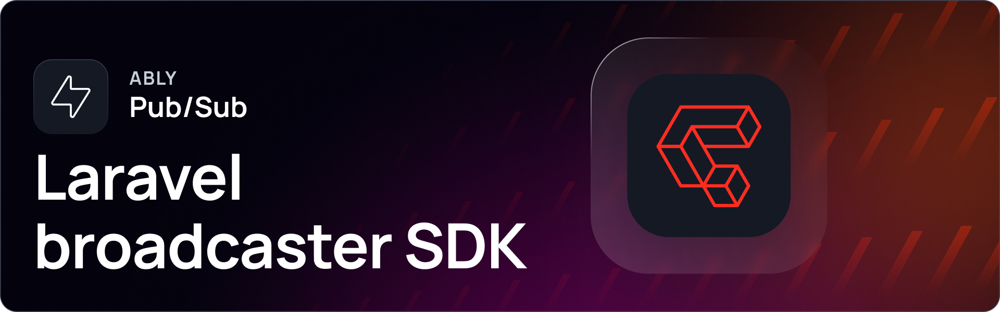

[](https://packagist.org/packages/ably/laravel-broadcaster)
[](https://packagist.org/packages/ably/laravel-broadcaster)
[](https://packagist.org/packages/ably/laravel-broadcaster)

# Ably Pub/Sub Laravel Broadcaster SDK 

_[Ably](https://ably.com) is the platform that powers synchronized digital experiences in realtime. Whether attending an event in a virtual venue, receiving realtime financial information, or monitoring live car performance data – consumers simply expect realtime digital experiences as standard. Ably provides a suite of APIs to build, extend, and deliver powerful digital experiences in realtime for more than 250 million devices across 80 countries each month. Organizations like Bloomberg, HubSpot, Verizon, and Hopin depend on Ably’s platform to offload the growing complexity of business-critical realtime data synchronization at global scale. For more information, see the [Ably documentation](https://ably.com/docs)._

This implements ably broadcaster as a independent service provider library for [Laravel](https://laravel.com/) using the [Ably Pub/Sub PHP SDK](https://github.com/ably/ably-pubsub-php) (`ably/pubsub-server`). This library works with the [ably-js](https://github.com/ably/ably-js) based [ably-laravel-echo](https://github.com/ably-forks/echo) client framework with enhanced features. This project is the successor to the [pusher-client based ably broadcaster](https://laravel.com/docs/9.x/broadcasting#client-ably).

## Features
- Native ably-js support.
- Low latency for client-events.
- Update channel permissions for each user.
- Update token expiry.
- Disable public channels.
- Fully compatible with pusher/pusher-compatible broadcasters, see [migrating section](#migrating-from-pusherpusher-compatible-broadcasters).

## Bug Fixes
- Fixes [broadcasting events to others](https://faqs.ably.com/why-isnt-the-broadcast-only-to-others-functionality-working-in-laravel-with-the-ably-broadcaster).
- Fixes intermittent presence leave issue for channel members.

## Requirements
1. PHP version >= 8.1
2. Laravel version >= 8.0
- On PHP 7.2 – 8.0 or Laravel 6 / 7, use `ably/laravel-broadcaster` 1.0.x, see [UPDATING.md](UPDATING.md#staying-on-10x).

## Installation

You can install the package via composer

```
composer require ably/laravel-broadcaster
```

> **Upgrading from 1.0.x?** See [UPDATING.md](UPDATING.md#10x--11).

## Setup

1. Update `.env` file, set `BROADCAST_CONNECTION` as `ably` and specify `ABLY_KEY`.
```dotenv
BROADCAST_CONNECTION=ably # For laravel <= 10, set `BROADCAST_DRIVER` instead
ABLY_KEY=ROOT_API_KEY_COPIED_FROM_ABLY_WEB_DASHBOARD
```
> **Warning** - Do not expose **ABLY_KEY** to client code.

On an MAU-billed Ably account, also set `mau_account` (see [Configure advanced features](#configure-advanced-features) / [UPDATING.md](UPDATING.md#mau-billed-ably-accounts)).

2. If using laravel 10 or older, uncomment/set [**BroadcastServiceProvider** in config/app.php](https://github.com/ably-labs/laravel-broadcast-app/blob/3ae9b9b97e05c1394bf128ae4dd905e245c7db71/config/app.php#L174)
<pre>
        App\Providers\AuthServiceProvider::class,
        <b>App\Providers\BroadcastServiceProvider::class,</b>
        App\Providers\EventServiceProvider::class,
</pre>

4. If running Laravel 8 or older, edit `config/broadcasting.php`, add `ably` section to the `connections` array
```php
        'ably' => [
            'driver' => 'ably',
            'key' => env('ABLY_KEY')
        ],
```
- For more information, refer to the [server-side broadcasting configuration documentation](https://laravel.com/docs/broadcasting#configuration).

Finally, you are ready to install and configure [Ably Laravel Echo](https://github.com/ably-forks/echo/), which will receive the broadcast events on the client-side.

## Using Laravel Echo on client-side

[Ably Laravel Echo](https://github.com/ably-forks/echo/) is a JavaScript library that makes it painless to subscribe to channels and listen for events broadcast by your server-side broadcasting driver. Ably is maintaining a fork of the official laravel-echo module which uses the official Ably device SDK, [`@ably/pubsub-device`](https://github.com/ably/ably-js), and brings it as its own dependency when you install it:
```
npm install @ably/laravel-echo@^1.1
```
`@ably/laravel-echo` >= 1.1 is required on MAU-billed Ably accounts and when `ABLY_MAU_ACCOUNT=true`; otherwise the 1.0.x setup keeps working. See [UPDATING.md](UPDATING.md#mau-billed-ably-accounts).

Once Echo is installed, you are ready to create a fresh Echo instance in your applications JavaScript. A great place to do this is at the bottom of the `resources/js/bootstrap.js` file that is included with the Laravel framework. By default, an example Echo configuration is already included in this file; however, the default configuration in the `bootstrap.js` file is intended for Pusher. You may copy the configuration below to transition your configuration to Ably.

```js
import Echo from '@ably/laravel-echo';

window.Echo = new Echo({
    broadcaster: 'ably',
});

window.Echo.connector.ably.connection.on(stateChange => {
    if (stateChange.current === 'connected') {
        console.log('connected to ably server');
    }
});

```
Please take a look at the [**Ably Laravel Echo Docs**](https://github.com/ably-forks/laravel-echo#readme) for more information related to configuring ably-specific client options and implementing additional features.

Once you have uncommented and adjusted the Echo configuration according to your needs, you may compile your application's assets:

```shell
npm run dev
```

## Configure advanced features

**1. Modify private/presence channel capability. Default: Full capability**
- Channel access control rights are granted for each individual user separately using `ably-capability`. It defines list of access claims as per [Channel Capabilities](https://ably.com/docs/auth/capabilities#capability-operations).

```php
  // file - routes/channels.php
  // User authentication is allowed for private/presence channel returning truthy values and denied for falsy values.
  
  // for private channel
  Broadcast::channel('channel1', function ($user) {
      return ['ably-capability' => ["subscribe", "history"]];
  });
  
  // for presence channel
  Broadcast::channel('channel2', function ($user) {
      return ['id' => $user->id, 'name' => $user->name, 'ably-capability' => ["subscribe", "presence"]];
  });
```

**2. Disable public channels. Default: false**
- Set `ABLY_DISABLE_PUBLIC_CHANNELS` as **true** in **.env** file.
```dotenv
    ABLY_DISABLE_PUBLIC_CHANNELS=true
```
- Update ably section under `config/broadcasting.php` with
```php
        'ably' => [
            'driver' => 'ably',
            'key' => env('ABLY_KEY'),
            'disable_public_channels' => env('ABLY_DISABLE_PUBLIC_CHANNELS', false)
        ],
```

**3. Update token expiry. Default: 28800 seconds (8 hrs)**
- Default expiry set to 8 hrs in order to reduce CPU workload for auth requests. Check [discussion](https://github.com/ably/laravel-broadcaster/issues/55#issuecomment-2582845145).
- Set `ABLY_TOKEN_EXPIRY` in **.env** file.
```dotenv
    ABLY_TOKEN_EXPIRY=43200
```
- Update ably section under `config/broadcasting.php` with
```php
        'ably' => [
            'driver' => 'ably',
            'key' => env('ABLY_KEY'),
            'token_expiry' => env('ABLY_TOKEN_EXPIRY', 28800)
        ],
```

**4. Use internet time for issued token expiry. Default: false**
- If this option is enabled, internet time in UTC format is fetched from the Ably service and cached every 6 hrs. 
- This option is useful when using laravel-broadcaster on a server where, for some reason, the server clock cannot be kept synchronized through normal means.
- Set `ABLY_SYNC_SERVER_TIME` as **true** in **.env** file.
```dotenv
    ABLY_SYNC_SERVER_TIME=true
```
- Update ably section under `config/broadcasting.php` with
```php
        'ably' => [
            'driver' => 'ably',
            'key' => env('ABLY_KEY'),
            'sync_server_time' => env('ABLY_SYNC_SERVER_TIME', false)
        ],
```

**5. Issue guest clientIds to unauthenticated users. Default: false**
- Required on Ably accounts with monthly-active-user (MAU) pricing, which reject connections without a clientId. Other accounts may enable it too, for example to give guests a stable per-session identity. Enabling it needs `@ably/laravel-echo` >= 1.1 (in-page login and logout). See [UPDATING.md](UPDATING.md#mau-billed-ably-accounts) before enabling it.
- Set `ABLY_MAU_ACCOUNT` as **true** in **.env** file. Optionally set `ABLY_GUEST_ID_PREFIX`.
```dotenv
    ABLY_MAU_ACCOUNT=true
```
- Update ably section under `config/broadcasting.php` with
```php
        'ably' => [
            'driver' => 'ably',
            'key' => env('ABLY_KEY'),
            // Give guests a random clientId instead of null (required on MAU-billed accounts). Default: false
            'mau_account' => env('ABLY_MAU_ACCOUNT', false),
            // Cosmetic prefix of guest clientIds, used only when mau_account is true. Default: 'guest:'
            'guest_id_prefix' => env('ABLY_GUEST_ID_PREFIX', 'guest:'),
        ],
```


<a name="migrate-pusher-to-ably"></a>
## Migrating from pusher/pusher-compatible broadcasters
The Ably Laravel broadcaster is designed to be compatible with all Laravel broadcasting providers, such as [Pusher](https://laravel.com/docs/9.x/broadcasting#pusher-channels), [Ably with the Pusher adapter](https://laravel.com/docs/9.x/broadcasting#ably), and all [Pusher compatible open source broadcasters](https://laravel.com/docs/9.x/broadcasting#open-source-alternatives). Follow the below steps to migrate from other broadcasters.

**1. Leaving a channel**

To leave channel on the client side, use [Ably Channel Namespaces](https://ably.com/docs/general/channel-rules-namespaces) conventions, instead of [Pusher Channel Conventions](https://pusher.com/docs/channels/using_channels/channels/#channel-types).

```js
 // public channel
Echo.channel('channel1'); // subscribe to a public channel
// use this 
Echo.leaveChannel("public:channel1"); // ably convention for leaving public channel
// instead of 
Echo.leaveChannel("channel1"); // pusher convention for leaving public channel

// private channel
Echo.private('channel2'); // subscribe to a private channel
// use this 
Echo.leaveChannel("private:channel2"); // ably convention for leaving private channel
// instead of 
Echo.leaveChannel("private-channel2"); // pusher convention for leaving private channel

// presence channel
Echo.join('channel3');  // subscribe to a presence channel
// use this
Echo.leaveChannel("presence:channel3"); // ably convention for leaving presence channel
// instead of 
Echo.leaveChannel("presence-channel3"); // pusher convention for leaving presence channel
```

**2. Error handling**
- Please note that the [Ably laravel-echo client](https://github.com/ably-forks/laravel-echo) emits [Ably specific error codes](https://github.com/ably/ably-common/blob/main/protocol/errors.json) instead of [Pusher error codes](https://pusher.com/docs/channels/library_auth_reference/pusher-websockets-protocol/#error-codes).
- Ably emitted errors are descriptive and easy to understand, so it's more effective to take a corrective action.
- Ably errors are provided as an [ErrorInfo object](https://ably.com/docs/api/realtime-sdk/types#error-info) with full error context.
- If you are interacting with pusher errors in your project, be sure to update your code accordingly.
i.e. update from [pusher error codes](https://pusher.com/docs/channels/library_auth_reference/pusher-websockets-protocol/#error-codes) to [ably error codes](https://github.com/ably/ably-common/blob/main/protocol/errors.json).

```js
    channel.error(error => {
        if (error && error.code === 40142) { // ably token expired
            console.error(error);
            // take corrective action on UI
        }
    })
```

## Addtional Documentation
- Current README covers basic ably broadcaster+echo configuration for setting up laravel app and getting it running.
- Please take a look at [Laravel Broadcasting Doc](https://laravel.com/docs/broadcasting) for more information on broadcasting and receiving events.

## Example 
- We have created a demo web-chat app using Ably Broadcaster+Echo based on laravel.
- Visit https://github.com/ably-labs/laravel-broadcast-app for detailed information.


</br>

## Testing
- To run tests use 

``` bash
composer test
```
- Integration tested using [ably sandbox](https://ably.com/docs/client-lib-development-guide/test-api).
- Integration tests available at [ably-laravel-echo](https://github.com/ably-forks/laravel-echo/tree/master/tests/ably) repository.


## Changelog
Please see [CHANGELOG](CHANGELOG.md) for more information what has changed recently.

## Contributing
1. Fork it
2. Create your feature branch (`git checkout -b my-new-feature`)
3. Commit your changes (`git commit -am 'Add some feature'`)
4. Ensure you have added suitable tests and the test suite is passing (run `vendor/bin/phpunit`)
4. Push to the branch (`git push origin my-new-feature`)
5. Create a new Pull Request

Maintainer guides, including the release process, are in [CONTRIBUTING.md](CONTRIBUTING.md).

## Release Process
See [Release Process](CONTRIBUTING.md#release-process) in CONTRIBUTING.md.
