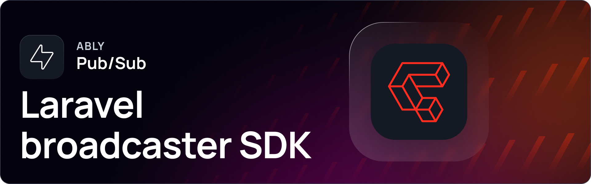

[](https://packagist.org/packages/ably/laravel-broadcaster)
[](https://packagist.org/packages/ably/laravel-broadcaster)
[](https://packagist.org/packages/ably/laravel-broadcaster)

# Ably Pub/Sub Laravel Broadcaster SDK 

_[Ably](https://ably.com) is the platform that powers synchronized digital experiences in realtime. Whether attending an event in a virtual venue, receiving realtime financial information, or monitoring live car performance data – consumers simply expect realtime digital experiences as standard. Ably provides a suite of APIs to build, extend, and deliver powerful digital experiences in realtime for more than 250 million devices across 80 countries each month. Organizations like Bloomberg, HubSpot, Verizon, and Hopin depend on Ably’s platform to offload the growing complexity of business-critical realtime data synchronization at global scale. For more information, see the [Ably documentation](https://ably.com/docs)._

This implements ably broadcaster as a independent service provider library for [Laravel](https://laravel.com/) using the [Ably Pub/Sub PHP SDK](https://github.com/ably/ably-pubsub-php) (`ably/pubsub-server`). This library works with the [ably-js](https://github.com/ably/ably-js) based [ably-laravel-echo](https://github.com/ably-forks/echo) client framework with enhanced features. This project is the successor to the [pusher-client based ably broadcaster](https://laravel.com/docs/9.x/broadcasting#client-ably).

## Features
- Native ably-js support.
- Low latency for client-events.
- Update channel permissions for each user.
- Update token expiry.
- Disable public channels.
- Fully compatible with pusher/pusher-compatible broadcasters, see [migrating section](#migrating-from-pusherpusher-compatible-broadcasters).

## Bug Fixes
- Fixes [broadcasting events to others](https://faqs.ably.com/why-isnt-the-broadcast-only-to-others-functionality-working-in-laravel-with-the-ably-broadcaster).
- Fixes intermittent presence leave issue for channel members.

## Requirements
1. PHP version >= 8.1 with the `curl`, `json` and `openssl` extensions
2. Laravel version >= 8.0 (on Laravel 8 this means exactly PHP 8.1, as Laravel 8 does not support PHP >= 8.2)
- On PHP 7.2 – 8.0 or Laravel 6 / 7, Composer keeps you on `ably/laravel-broadcaster` 1.0.x. It keeps working on accounts without monthly-active-user pricing, but 1.0.x is **rejected on MAU-enabled accounts** and only receives critical fixes until about October 2027.

## Installation

You can install the package via composer

```
composer require ably/laravel-broadcaster
```

> **Upgrading from 1.0.x?** The default Ably hosts change and egress allowlists may need updating; see [Upgrading to 1.1](#upgrading-to-11) and [Network requirements](#network-requirements).

## Setup

1. Update `.env` file, set `BROADCAST_CONNECTION` as `ably` and specify `ABLY_KEY`.
```dotenv
BROADCAST_CONNECTION=ably # For laravel <= 10, set `BROADCAST_DRIVER` instead
ABLY_KEY=ROOT_API_KEY_COPIED_FROM_ABLY_WEB_DASHBOARD
```
> **Warning** - Do not expose **ABLY_KEY** to client code.

2. If using laravel 10 or older, uncomment/set [**BroadcastServiceProvider** in config/app.php](https://github.com/ably-labs/laravel-broadcast-app/blob/3ae9b9b97e05c1394bf128ae4dd905e245c7db71/config/app.php#L174)
<pre>
        App\Providers\AuthServiceProvider::class,
        <b>App\Providers\BroadcastServiceProvider::class,</b>
        App\Providers\EventServiceProvider::class,
</pre>

4. If running Laravel 8 or older, edit `config/broadcasting.php`, add `ably` section to the `connections` array
```php
        'ably' => [
            'driver' => 'ably',
            'key' => env('ABLY_KEY')
        ],
```
- For more information, refer to the [server-side broadcasting configuration documentation](https://laravel.com/docs/broadcasting#configuration).

Finally, you are ready to install and configure [Ably Laravel Echo](https://github.com/ably-forks/echo/), which will receive the broadcast events on the client-side.

## Using Laravel Echo on client-side

[Ably Laravel Echo](https://github.com/ably-forks/echo/) is a JavaScript library that makes it painless to subscribe to channels and listen for events broadcast by your server-side broadcasting driver. Ably is maintaining a fork of the official laravel-echo module which allows you to use the official [ably-js SDK](https://github.com/ably/ably-js). From 1.1.0 it brings the official Ably device SDK, `@ably/pubsub-device`, as its own dependency, so a single command installs everything:
```
npm install @ably/laravel-echo@^1.1
```
`@ably/laravel-echo` >= 1.1.0 (release pending) is required on [MAU-billed Ably accounts](#mau-billed-ably-accounts) and when `ABLY_MAU_ACCOUNT=true`; otherwise the 1.0.x setup keeps working.

Once Echo is installed, you are ready to create a fresh Echo instance in your applications JavaScript. A great place to do this is at the bottom of the `resources/js/bootstrap.js` file that is included with the Laravel framework. By default, an example Echo configuration is already included in this file; however, the default configuration in the `bootstrap.js` file is intended for Pusher. You may copy the configuration below to transition your configuration to Ably.

```js
import Echo from '@ably/laravel-echo';

window.Echo = new Echo({
    broadcaster: 'ably',
});

window.Echo.connector.ably.connection.on(stateChange => {
    if (stateChange.current === 'connected') {
        console.log('connected to ably server');
    }
});

```
Please take a look at the [**Ably Laravel Echo Docs**](https://github.com/ably-forks/laravel-echo#readme) for more information related to configuring ably-specific client options and implementing additional features.

Once you have uncommented and adjusted the Echo configuration according to your needs, you may compile your application's assets:

```shell
npm run dev
```

## MAU-billed Ably accounts
Ably accounts with monthly-active-user (MAU) pricing only accept identified clients, and only SDKs that declare their side (device or server). Connections that do not meet this are rejected after the socket opens, the client goes to `failed` and does not retry:

| Ably error | Status | When it is returned |
|---|---|---|
| 40161 | 401 | A device connection has no clientId (`null`), or the wildcard `*`. This is what an unauthenticated visitor, or a user who has just logged out, gets by default. |
| 40167 | 401 | A server client authenticates with a token that lacks the signed `x-ably-clientType: server` claim. |
| 40168 | 400 | The SDK does not declare its side, e.g. the `ably` (ably-js) package. Use `@ably/laravel-echo` >= 1.1.0, which uses `@ably/pubsub-device`. |

`ABLY_MAU_ACCOUNT` issues guest clientIds to unauthenticated users. It is required on MAU-billed accounts, and it may be enabled on other accounts too. To serve guests on an MAU-billed account:
- Set `ABLY_MAU_ACCOUNT=true` and add the `mau_account` line to the `ably` connection in `config/broadcasting.php`, see [Configure advanced features](#configure-advanced-features). This package ships no config file, so the line is needed.
- Unauthenticated clients are then issued a guest clientId instead of `null`: `<prefix><random>.<tag>`, where `<random>` is 22 characters (the base64url encoding of 16 random bytes) and `<tag>` is a 22 character HMAC of it, keyed with your API key secret. Rotating `ABLY_KEY` invalidates the tags. Guests on routes without a session then get a new id once; ids kept in the session are unaffected.
- The prefix defaults to `guest:` and can be changed with `ABLY_GUEST_ID_PREFIX`. It is cosmetic and **not reserved**: the broadcaster recognises the guest ids it issued by their tag alone, so a real user id that starts with `guest:` is legal and unaffected. The prefix is only used when `ABLY_MAU_ACCOUNT=true`.
- The guest id is stable for the session, so one visitor is one MAU. A guest gets a new id after logout.
- Guests can still only use public channels; private and presence channels require a signed-in user.
- Each guest counts as a monthly active user on your Ably account.
- Logging in without reloading the page (SPA) switches the connection from one non-null clientId to another, which needs `@ably/laravel-echo` >= 1.1.0 (release pending). After an in-page logout, call `Echo.connect()` (or create a new Echo instance) to connect as the new guest at once. Other open tabs switch to the new identity by themselves at their next connection token renewal (within `token_expiry`, 8 hours by default): the user after a login, a fresh guest id after a logout. This also needs `@ably/laravel-echo` >= 1.1.0. To switch every tab at once, call `Echo.connect()` in each tab, for example from a `BroadcastChannel` message (see the [Ably Laravel Echo README](https://github.com/ably-forks/laravel-echo#readme)). With an older Echo, guests connect, but in-page login breaks, and other open tabs fail with a clientId mismatch (40102) at their next renewal after a login or logout; only a page reload recovers them.
- With `ABLY_MAU_ACCOUNT` left off on an MAU-billed account, guests fail with 40161, and `@ably/laravel-echo` logs this hint in the browser console: "Your Ably account requires an identified client on every connection (MAU billing), but this guest connected without a clientId. In laravel-broadcaster set ABLY_MAU_ACCOUNT=true (config broadcasting.connections.ably.mau_account) so guests receive a clientId, or only connect Echo for signed-in users."
- The server-side client must authenticate with the API key (`ABLY_KEY`). Server-side token auth is not supported.
- **Default changes in 2.0.0.** The default of `ABLY_MAU_ACCOUNT` will change to `true` in 2.0.0. Set it explicitly to keep the current behaviour: `ABLY_MAU_ACCOUNT=false` keeps null guest clientIds, and `ABLY_MAU_ACCOUNT=true` gives guests a random clientId (requires `@ably/laravel-echo` >= 1.1.0).

## Configure advanced features

**1. Modify private/presence channel capability. Default: Full capability**
- Channel access control rights are granted for each individual user separately using `ably-capability`. It defines list of access claims as per [Channel Capabilities](https://ably.com/docs/auth/capabilities#capability-operations).

```php
  // file - routes/channels.php
  // User authentication is allowed for private/presence channel returning truthy values and denied for falsy values.
  
  // for private channel
  Broadcast::channel('channel1', function ($user) {
      return ['ably-capability' => ["subscribe", "history"]];
  });
  
  // for presence channel
  Broadcast::channel('channel2', function ($user) {
      return ['id' => $user->id, 'name' => $user->name, 'ably-capability' => ["subscribe", "presence"]];
  });
```

**2. Disable public channels. Default: false**
- Set `ABLY_DISABLE_PUBLIC_CHANNELS` as **true** in **.env** file.
```dotenv
    ABLY_DISABLE_PUBLIC_CHANNELS=true
```
- Update ably section under `config/broadcasting.php` with
```php
        'ably' => [
            'driver' => 'ably',
            'key' => env('ABLY_KEY'),
            'disable_public_channels' => env('ABLY_DISABLE_PUBLIC_CHANNELS', false)
        ],
```

**3. Update token expiry. Default: 28800 seconds (8 hrs)**
- Default expiry set to 8 hrs in order to reduce CPU workload for auth requests. Check [discussion](https://github.com/ably/laravel-broadcaster/issues/55#issuecomment-2582845145).
- Set `ABLY_TOKEN_EXPIRY` in **.env** file.
```dotenv
    ABLY_TOKEN_EXPIRY=43200
```
- Update ably section under `config/broadcasting.php` with
```php
        'ably' => [
            'driver' => 'ably',
            'key' => env('ABLY_KEY'),
            'token_expiry' => env('ABLY_TOKEN_EXPIRY', 28800)
        ],
```

**4. Use internet time for issued token expiry. Default: false**
- If this option is enabled, internet time in UTC format is fetched from the Ably service and cached every 6 hrs. 
- This option is useful when using laravel-broadcaster on a server where, for some reason, the server clock cannot be kept synchronized through normal means.
- Set `ABLY_SYNC_SERVER_TIME` as **true** in **.env** file.
```dotenv
    ABLY_SYNC_SERVER_TIME=true
```
- Update ably section under `config/broadcasting.php` with
```php
        'ably' => [
            'driver' => 'ably',
            'key' => env('ABLY_KEY'),
            'sync_server_time' => env('ABLY_SYNC_SERVER_TIME', false)
        ],
```

**5. Issue guest clientIds to unauthenticated users (`ABLY_MAU_ACCOUNT`). Default: false**
- When enabled, clients without a signed-in user receive a guest clientId (`<prefix><random>.<tag>`, stable per session, a new one after logout) instead of `null`. Required on [MAU-billed Ably accounts](#mau-billed-ably-accounts); other accounts may enable it too. In-page login and logout need `@ably/laravel-echo` >= 1.1.0 (release pending).
- Set `ABLY_MAU_ACCOUNT` as **true** in **.env** file. Optionally set `ABLY_GUEST_ID_PREFIX` (default `guest:`; cosmetic, not reserved, only used when `ABLY_MAU_ACCOUNT=true`).
```dotenv
    ABLY_MAU_ACCOUNT=true
```
- Update ably section under `config/broadcasting.php` with the lines below. This package ships no config file, so without them the env variables have no effect (and under `php artisan config:cache`, `env()` is only read through the config file).
```php
        'ably' => [
            'driver' => 'ably',
            'key' => env('ABLY_KEY'),
            'mau_account' => env('ABLY_MAU_ACCOUNT', false),
            'guest_id_prefix' => env('ABLY_GUEST_ID_PREFIX', 'guest:'),
        ],
```
- **Default changes in 2.0.0.** The default of `ABLY_MAU_ACCOUNT` will change to `true` in 2.0.0. Set it explicitly to keep the current behaviour: `ABLY_MAU_ACCOUNT=false` keeps null guest clientIds, and `ABLY_MAU_ACCOUNT=true` gives guests a random clientId (requires `@ably/laravel-echo` >= 1.1.0).
- The id is kept in the session as `ably_guest_client_id`. On routes without a session, the guest id in the still-valid token that the client presents is reused if its tag verifies; otherwise a new one is generated.
- To use your own scheme, register a resolver, e.g. in a service provider. It receives the request and must return a non-empty id other than `*`; it is used as returned (no prefix or tag is added). A closure cannot live in the config file, as it breaks `php artisan config:cache`.
```php
  \Ably\LaravelBroadcaster\AblyBroadcaster::resolveGuestClientIdUsing(function ($request) {
      return 'visitor:'.$request->cookie('visitor_id');
  });
```

### Ably client options
- Any other key in the `ably` connection config is passed through to `Ably\PubSub\Server::createHttpClient()` as an Ably client option, see the [client options of the SDK](https://github.com/ably/ably-pubsub-php).
- `key` is required. A missing or empty `key` fails with Ably error 40103.
- `agents` is set by the broadcaster, a value you set is overwritten.
- Server-side token auth is not supported: the broadcaster always authenticates with its API key. `useTokenAuth` is ignored. A config without `key` fails with Ably error 40103, even if `token`, `authUrl` or `authCallback` is set. Basic auth requires TLS, so `tls => false` together with a `key` fails with Ably error 40103.
- Option values must be serializable for `php artisan config:cache`, so do not use closures.

## Network requirements
From 1.1 the broadcaster calls `main.realtime.ably.net` and falls back to `main.[a-e].fallback.ably-realtime.com`
(1.0.x used `rest.ably.io` and `[a-e].ably-realtime.com`). Allow `*.realtime.ably.net` and `*.fallback.ably-realtime.com`
in egress firewalls and proxies. Proxies are configured with `http_proxy` / `https_proxy` in `$_SERVER`, as before.
If these hosts are blocked, publishing fails with `BroadcastException`. If packets are dropped rather than rejected,
each publish can block for about 16 seconds (4 s connect timeout × up to 4 hosts), so check queue job timeouts.
With `sync_server_time` enabled, the broadcaster requests Ably's server time (`GET /time`) when it is created and its cached value is missing or older than 6 hours (e.g. after a fresh deploy).
Apps that use `ably` as the default broadcaster and load `routes/channels.php` create the broadcaster while booting, so blocked egress then fails every request and artisan command, not only auth and broadcasting.
Browsers: legacy ably-js 1.x still connects to `realtime.ably.io` / `*.ably-realtime.com`, which DNS now points (CNAME) at the new domains. Allowlists that match on resolved names or addresses need the new domains too.

## Upgrading to 1.1
Version 1.1 moves from `ably/ably-php` 1.x to [`ably/pubsub-server`](https://github.com/ably/ably-pubsub-php) 2.x, whose clients declare the server side as monthly-active-user pricing requires. The documented `config/broadcasting.php` options keep working unchanged; check the points below.
1. **Network / firewall first:** allow the new hosts listed in [Network requirements](#network-requirements). With `sync_server_time` enabled, blocked hosts make the whole app fail, not only broadcasting.
2. Update: `composer update ably/laravel-broadcaster`. Add `-W` only if `rybakit/msgpack` 0.10/0.11 is locked (`ably/pubsub-server` currently constrains it to 0.9.x); `composer why-not ably/laravel-broadcaster 1.1.0` shows what blocks the update.
3. If you construct `AblyBroadcaster` yourself, pass a client created with `\Ably\PubSub\Server::createHttpClient()`; any other value throws `InvalidArgumentException`.
4. If you reference `Ably\…` SDK classes (e.g. in a subclass), rename them to `Ably\PubSub\…`. For example, `buildAblyMessage()` overrides must return `Ably\PubSub\Models\Message`, and `Utils::decodeSocketId()` throws `Ably\PubSub\Exceptions\AblyException` (`broadcast()` still throws `BroadcastException`).
5. `ably/ably-php` is no longer installed for you. Require `ably/ably-php:^1.1` yourself if you use `Ably\AblyRest` directly. Do not bump `ably/ably-php` to 2.x; this package declares a conflict with it.
6. Make sure this package's service provider is registered (package discovery does it by default). If it is not, Laravel's built-in `ably` driver is used, and that driver needs `Ably\AblyRest`.
7. Client side: `broadcast(...)->toOthers()` needs `@ably/laravel-echo` >= 1.0.6, and ably-js <= 1.2.35 is sunset. For MAU-billed accounts, or with `ABLY_MAU_ACCOUNT=true`, use `npm install @ably/laravel-echo@^1.1` (release pending), then rebuild assets.
8. Add `'mau_account' => env('ABLY_MAU_ACCOUNT', false),` (and optionally `'guest_id_prefix' => env('ABLY_GUEST_ID_PREFIX', 'guest:'),`) to the `ably` connection in `config/broadcasting.php` (this package ships no config file). On an MAU-billed Ably account set `ABLY_MAU_ACCOUNT=true`, see [MAU-billed Ably accounts](#mau-billed-ably-accounts). It is off by default, and nothing changes for you if you leave it off. **Default changes in 2.0.0:** the default of `ABLY_MAU_ACCOUNT` will change to `true` in 2.0.0. Set it explicitly to keep the current behaviour.
9. **Behaviour change:** a token's capabilities are no longer carried over when the clientId changes, e.g. on logout or when another user signs in. The new identity starts with the public channel capability plus the channel being authorized. Capabilities are still carried over when renewing a token for the same clientId.
10. An empty or missing `key` now always fails with Ably error 40103 and a message naming `key` / `ABLY_KEY`, also when `token`, `authUrl` or `authCallback` is set. The broadcaster needs the API key to sign client tokens. `useTokenAuth` is ignored: the broadcaster always uses basic auth with its API key. Basic auth requires TLS, so `tls => false` together with a `key` fails with Ably error 40103.
11. If you set `environment`, `restHost` or `port` as client options, switch to `endpoint`, see the SDK's [UPDATING.md](https://github.com/ably/ably-pubsub-php/blob/main/UPDATING.md).
12. Restart queue workers, Horizon and Octane after deploying.


<a name="migrate-pusher-to-ably"></a>
## Migrating from pusher/pusher-compatible broadcasters
The Ably Laravel broadcaster is designed to be compatible with all Laravel broadcasting providers, such as [Pusher](https://laravel.com/docs/9.x/broadcasting#pusher-channels), [Ably with the Pusher adapter](https://laravel.com/docs/9.x/broadcasting#ably), and all [Pusher compatible open source broadcasters](https://laravel.com/docs/9.x/broadcasting#open-source-alternatives). Follow the below steps to migrate from other broadcasters.

**1. Leaving a channel**

To leave channel on the client side, use [Ably Channel Namespaces](https://ably.com/docs/general/channel-rules-namespaces) conventions, instead of [Pusher Channel Conventions](https://pusher.com/docs/channels/using_channels/channels/#channel-types).

```js
 // public channel
Echo.channel('channel1'); // subscribe to a public channel
// use this 
Echo.leaveChannel("public:channel1"); // ably convention for leaving public channel
// instead of 
Echo.leaveChannel("channel1"); // pusher convention for leaving public channel

// private channel
Echo.private('channel2'); // subscribe to a private channel
// use this 
Echo.leaveChannel("private:channel2"); // ably convention for leaving private channel
// instead of 
Echo.leaveChannel("private-channel2"); // pusher convention for leaving private channel

// presence channel
Echo.join('channel3');  // subscribe to a presence channel
// use this
Echo.leaveChannel("presence:channel3"); // ably convention for leaving presence channel
// instead of 
Echo.leaveChannel("presence-channel3"); // pusher convention for leaving presence channel
```

**2. Error handling**
- Please note that the [Ably laravel-echo client](https://github.com/ably-forks/laravel-echo) emits [Ably specific error codes](https://github.com/ably/ably-common/blob/main/protocol/errors.json) instead of [Pusher error codes](https://pusher.com/docs/channels/library_auth_reference/pusher-websockets-protocol/#error-codes).
- Ably emitted errors are descriptive and easy to understand, so it's more effective to take a corrective action.
- Ably errors are provided as an [ErrorInfo object](https://ably.com/docs/api/realtime-sdk/types#error-info) with full error context.
- If you are interacting with pusher errors in your project, be sure to update your code accordingly.
i.e. update from [pusher error codes](https://pusher.com/docs/channels/library_auth_reference/pusher-websockets-protocol/#error-codes) to [ably error codes](https://github.com/ably/ably-common/blob/main/protocol/errors.json).

```js
    channel.error(error => {
        if (error && error.code === 40142) { // ably token expired
            console.error(error);
            // take corrective action on UI
        }
    })
```
**Note :**
- In the `Echo.join().here(members => {})` implementation, members are updated every time a client **joins, updates or leaves** the channel, whereas when using Pusher this is only called once for first client entering the channel.
- Ably behaviour follows the standard Echo [PresenceChannel Interface `here` Method](https://github.com/laravel/echo/blob/master/src/channel/presence-channel.ts#L10).

## Addtional Documentation
- Current README covers basic ably broadcaster+echo configuration for setting up laravel app and getting it running.
- Please take a look at [Laravel Broadcasting Doc](https://laravel.com/docs/broadcasting) for more information on broadcasting and receiving events.

## Example 
- We have created a demo web-chat app using Ably Broadcaster+Echo based on laravel.
- Visit https://github.com/ably-labs/laravel-broadcast-app for detailed information.


</br>

## Testing
- To run tests use 

``` bash
composer test
```
- Integration tested using [ably sandbox](https://ably.com/docs/client-lib-development-guide/test-api).
- Integration tests available at [ably-laravel-echo](https://github.com/ably-forks/laravel-echo/tree/master/tests/ably) repository.


## Changelog
Please see [CHANGELOG](CHANGELOG.md) for more information what has changed recently.

## Contributing
1. Fork it
2. Create your feature branch (`git checkout -b my-new-feature`)
3. Commit your changes (`git commit -am 'Add some feature'`)
4. Ensure you have added suitable tests and the test suite is passing (run `vendor/bin/phpunit`)
4. Push to the branch (`git push origin my-new-feature`)
5. Create a new Pull Request

## Release Process
This library uses [semantic versioning](http://semver.org/). For each release, the following needs to be done:

1. Create a new branch for the release, named like `release/1.1.0` (where `1.1.0` is what you're releasing, being the new version). Critical fixes for 1.0.x go to the `1.0.x` branch.
2. Update the lib version in `src/AblyBroadcaster.php`.
3. Run [`github_changelog_generator`](https://github.com/github-changelog-generator/github-changelog-generator) to automate the update of the [CHANGELOG.md](CHANGELOG.md). This may require some manual intervention, both in terms of how the command is run and how the change log file is modified. Your mileage may vary:
  - The command you will need to run will look something like this: `github_changelog_generator -u ably -p laravel-broadcaster --since-tag v1.0.6 --output delta.md --token $GITHUB_TOKEN_WITH_REPO_ACCESS`. Generate token [here](https://github.com/settings/tokens/new?description=GitHub%20Changelog%20Generator%20token).
  - Using the command above, `--output delta.md` writes changes made after `--since-tag` to a new file.
  - The contents of that new file (`delta.md`) then need to be manually inserted at the top of the `CHANGELOG.md`, changing the "Unreleased" heading and linking with the current version numbers.
  - Also ensure that the "Full Changelog" link points to the new version tag instead of the `HEAD`.
4. Commit generated [CHANGELOG.md](./CHANGELOG.md) file.
5. Make a PR against `main`.
6. Once the PR is approved, merge it into `main`.
7. Add a tag and push it to origin - e.g.: `git tag v1.0.6 && git push origin v1.0.6`.
8. Visit https://github.com/ably/laravel-broadcaster/tags and add release notes for the release including links to the changelog entry.
9. Visit https://packagist.org/packages/ably/laravel-broadcaster, log in to Packagist, and click the "Update" button.
10. Create the entry on the [Ably Changelog](https://changelog.ably.com/) (via [headwayapp](https://headwayapp.co/))
